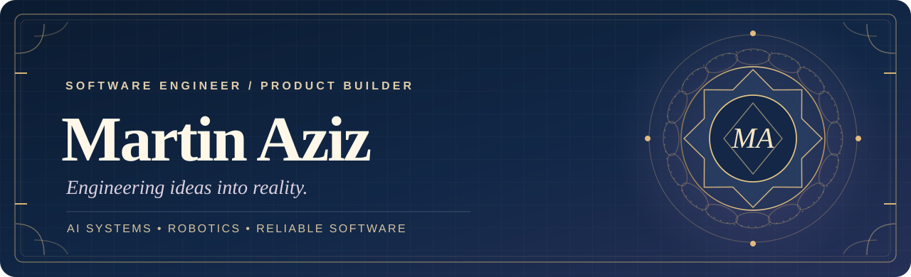
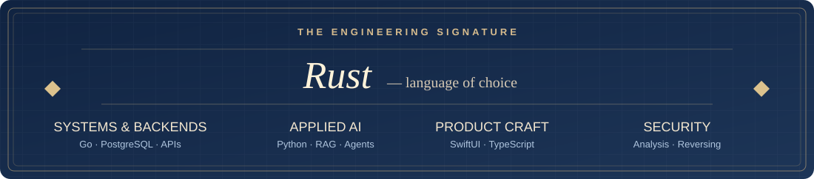
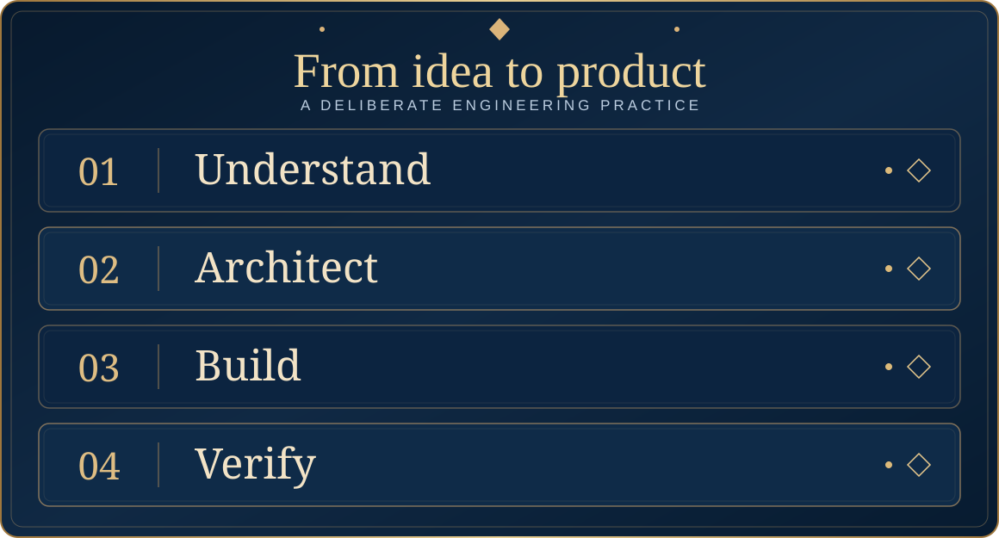

<!-- Minimal editorial profile. Keep descriptions broad and avoid project-specific disclosures. -->

  

<strong>From first principles to finished software.</strong>

  I turn complex ideas into thoughtful, reliable products — from problem definition and system architecture to implementation, verification, and user experience.

  

  

---

  

  I start with the real problem and its constraints, design clear system boundaries, build a complete usable experience, and verify the edge cases before refining the details.

## What I optimize for

  <strong>Clarity</strong> — Understand the problem before choosing the tools. 
  <strong>Reliability</strong> — Design for failure, recovery, and verifiable outcomes. 
  <strong>Craft</strong> — Make the final experience useful, intuitive, and considered.

BUILD WITH INTENTION &nbsp;·&nbsp; DESIGN FOR REAL PEOPLE &nbsp;·&nbsp; VERIFY WHAT MATTERS

