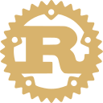
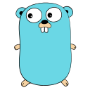
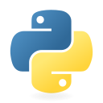
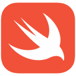

<!-- Quiet portfolio: engineering substance without venture or contribution disclosures. -->

  

  <strong>From first principles to finished software.</strong>

  I turn complex ideas into thoughtful, reliable products — from understanding a problem and designing the architecture to building, testing, and refining the experience.

  

LANGUAGES I BUILD WITH

   &nbsp;&nbsp;
   &nbsp;&nbsp;
   &nbsp;&nbsp;
   &nbsp;&nbsp;
  

<strong>Rust</strong> · Go · Python · TypeScript · Swift

  

### From idea to product

  <strong>Understand</strong> &nbsp;✧&nbsp; <strong>Architect</strong> &nbsp;✧&nbsp; <strong>Build</strong> &nbsp;✧&nbsp; <strong>Verify</strong>

Every stage has a purpose: clarify the real problem, design the boundaries, make the experience useful, and test what happens beyond the happy path.

### The engineering beneath the interface

- **Recoverability** — concurrency, idempotency, retries, and explicit failure states.
- **Trust boundaries** — least-privilege access, authorization, and traceable decisions.
- **Evidence** — automated tests, meaningful edge cases, and observability.

---

<strong>Let's talk engineering.</strong>

I enjoy conversations about reliable systems, applied AI, and software that brings thoughtful ideas into everyday use.

  <a href="https://www.linkedin.com/in/martinushd/">Connect on LinkedIn</a>

BUILD WITH INTENTION &nbsp;·&nbsp; DESIGN FOR PEOPLE &nbsp;·&nbsp; VERIFY WHAT MATTERS

